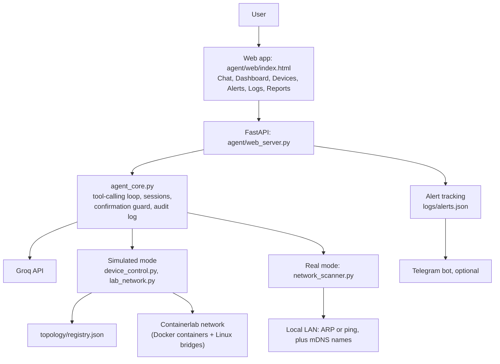
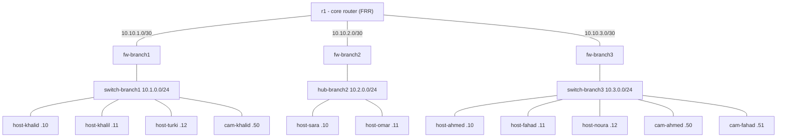

# FYP-Netmind (NetMind)

NetMind is an LLM-powered network operations assistant, built as a final-year
graduation project at Prince Sattam Bin Abdulaziz University (PSAU).

You talk to it in English or Arabic, and it answers by calling tools against a
network:

- **Simulated mode:** a Containerlab network (core router, branch firewalls,
  switches and hubs, hosts and IP cameras) that NetMind can query and control:
  device power, firewall rules, camera streams and credentials, and
  connectivity checks.
- **Real-network mode:** discovery of devices on the local LAN and online/offline
  checks. This mode is read-only; it cannot control real devices.

A single web app combines the chat with a live dashboard, alert history,
an audit trail and a security/reliability report.

## Team

| Name | ID | Role |
|---|---|---|
| Khaled Ibrahim Alghmlas | 445050235 | Core backend, topology, device control, agent core and safety |
| Faleh Hamoud Alsubaie | 445050053 | Real-network scanner, web UI, lab connectivity tools |
| Ibrahim Abdulrahman Alharthi | 445050024 | Dashboard, app shell, evidence view, logs, notifications |
| Turki Khaled bin Askar | 445050245 | Team member |

**Supervisor:** Dr. Khalil Chebil

## Architecture



The dashboard and the chat use the same device functions. The dashboard polls
the API every 5 seconds; each poll compares device status with the previous
poll and raises or closes alerts.

## Simulated network

`topology/branches.py` is the single source of truth for the layout and IP plan.



## Stack

- **Network emulation:** [Containerlab](https://containerlab.dev/) on native
  `docker-ce` inside a WSL2 Ubuntu distro (not Docker Desktop's own engine;
  see [Setup](#setup)).
- **Router:** `frrouting/frr`.
- **Firewalls:** custom `netmind-firewall` image (Alpine + `iptables`) with
  live firewall rules.
- **Cameras:** custom `netmind-camera` image (Alpine + Python) with a fake HTTP
  service simulating camera stream and snapshot endpoints.
- **Switches and hubs:** Linux bridges on the host.
- **LLM:** Groq API (`openai/gpt-oss-120b`) with tool calling.
- **Backend:** FastAPI + Docker SDK.
- **Frontend:** a single vanilla JavaScript app with English/Arabic and
  light/dark themes.
- **Quality:** `ruff`, `pytest` (unit, integration and a Playwright UI smoke
  test) and GitHub Actions CI.

## Repository layout

```text
.
├── agent/
│   ├── agent_core.py          # Tool-calling loop, sessions, confirmation guard, audit log
│   ├── device_control.py      # Control and inspect simulated lab devices
│   ├── lab_network.py         # ping_between, re-attach a device to its switch after power-on
│   ├── network_scanner.py     # Discover and check devices on the real LAN
│   ├── web_server.py          # FastAPI backend, REST API, alerts, Telegram notifications
│   ├── netmind_agent.py       # Older terminal REPL (simulated mode, basic tools only)
│   └── web/
│       └── index.html         # The web app: chat, dashboard, devices, alerts, logs, reports
├── collectors/                # Reserved for a future background collector
├── docker/
│   ├── camera/                # Camera image and service scripts
│   └── firewall/              # Firewall image and entrypoint
├── docs/
│   └── REPORT.md              # System assessment and 7-month enhancement plan
├── tests/                     # Unit tests (no Docker or API key needed)
│   ├── integration/           # Tests against the running lab
│   └── ui/                    # Headless-browser smoke test
├── topology/
│   ├── branches.py            # Shared network layout and IP plan
│   ├── generate_topology.py   # Generates netmind-large.clab.yml and host bridges
│   ├── build_registry.py      # Builds machine-specific registry.json
│   ├── netmind-lab.clab.yml   # Small starter topology
│   └── netmind-large.clab.yml # Generated full topology
├── Makefile                   # make up / down / run / test / lint
├── CONTRIBUTING.md
└── requirements.txt
```

## Features

### Chat (natural language)

**Simulated mode:**

| Area | What you can ask |
|---|---|
| Devices | Status, IP, list all devices, list devices on a switch/hub, power on, power off. Names can be a device id (`host-ahmed`) or an owner (`ahmed`), and small typos are tolerated. |
| Connectivity | `ping_between` two lab devices over the lab network (not the management network). |
| Firewalls (`fw-branch1/2/3`) | List live `iptables` rules, show open ports, audit for sensitive ports (SSH, Telnet, FTP, RDP) open to any source, block or allow a port. |
| Cameras (`cam-khalid`, `cam-ahmed`, `cam-fahad`) | Check whether the stream answers over HTTP, start or stop the stream, check for the default password, change the password. |

**Real-network mode:** scan the local network (IP, MAC, hostname, scan method),
check whether a device is online, resolve a hostname.

Each chat reply can show its **evidence**: the tool calls the agent made and
their results.

### Web app

- **Dashboard:** device counts, topology view coloured by status, recent alerts.
- **Devices:** every device with type, IP and status, with power buttons
  (power-off still asks for confirmation).
- **Alerts:** full history. A device going offline opens an alert; coming back
  closes it and records how long it was down. Firewall and camera audit
  findings also raise alerts.
- **Logs:** audit trail of every action: who asked (chat, dashboard or user),
  what, on which device, and the outcome. In real mode, devices joining or
  leaving the network.
- **Reports:** a one-page summary of open security findings, outages, average
  and longest recovery time, and actions by outcome.
- **Telegram notifications (optional):** alerts and recoveries are sent to a
  Telegram chat with device, severity and timestamp. A test button checks the
  setup.

## Safety

- Destructive actions (`power_off`, `block_port`, `allow_port`,
  `change_camera_credentials`) are never executed straight from the model.
  They create a *pending action* that the user must confirm with the Confirm
  button. Pending actions expire after 5 minutes.
- Protected devices (`r1` and all firewalls) need an extra acknowledgement.
- If the model claims an action is pending without calling the tool, the agent
  asks it to retry and call the tool.
- Every tool call is written to an audit log (`GET /api/audit` and
  `logs/audit.jsonl`). Camera passwords are redacted in the log.
- Firewall rules are applied to both the INPUT and FORWARD chains, so a
  blocked port is also blocked for traffic passing through the firewall to
  other branches.
- The server only accepts requests from its own page, and `make run` binds to
  `127.0.0.1`. There is no login yet.

## Setup

1. Install a **native `docker-ce`** engine inside your WSL2 Ubuntu distro.
   Docker Desktop's engine does not reliably expose the network-namespace and
   bridge access Containerlab needs.
2. Install [Containerlab](https://containerlab.dev/) inside that same distro.
3. Create a Python virtual environment and install dependencies:

   ```bash
   python3 -m venv .venv
   source .venv/bin/activate
   pip install -r requirements.txt
   ```

4. Add a `.env` file at the repository root (it is gitignored):

   ```dotenv
   GROQ_API_KEY=your_key_here

   # Optional: Telegram alert notifications
   TELEGRAM_BOT_TOKEN=your_bot_token
   TELEGRAM_CHAT_ID=your_chat_id
   ```

### Deploy the simulated lab (one command)

From the repository root:

```bash
make up     # build images, create bridges (idempotent), deploy lab, build registry.json
make down   # destroy the lab
```

`make up` is safe to re-run, including after a host reboot: it recreates the
Linux bridges and host FORWARD rules only if they are missing, then deploys
with `containerlab deploy --reconfigure` and runs `build_registry.py`.
Individual steps are available as `make lab-build`, `make lab-bridges` and
`make lab-up`. `topology/registry.json` is machine-specific and gitignored.

Firewall rule changes survive NetMind power cycles but reset after
`make down` and a redeploy.

### Allow power-on without running as root

Powering a device back on re-attaches it to its switch with
`containerlab tools veth`, which needs root. Instead of running the whole
server with `sudo`, allow just that command. Run
`sudo visudo -f /etc/sudoers.d/netmind` and add one line (replace `youruser`,
and check the path with `which containerlab`):

```
youruser ALL=(root) NOPASSWD: /usr/bin/containerlab tools veth *
```

## Run NetMind

With the virtual environment activated, the lab deployed, and `.env` set, from
the repository root:

```bash
make run    # same as: cd agent && uvicorn web_server:app --host 127.0.0.1 --reload
```

Open <http://127.0.0.1:8000/>. Use the mode switch to choose **Simulated**
(the Containerlab lab) or **Real Network** (your LAN).

In real mode the scanner guesses the local `/24` subnet from the machine's
default-route IP. It uses ARP when Scapy and raw-socket permissions are
available; otherwise it falls back to ping (and reports which method ran).
mDNS adds hostnames when devices advertise one. Only scan networks you are
authorised to scan.

To run a one-off real-network scan from the `agent/` directory:

```bash
python3 network_scanner.py
```

Runtime data is kept in `logs/` (gitignored): `alerts.json` for alert history
and `audit.jsonl` for the audit log. Delete them to start from a clean slate.

## API

| Method | Path | Purpose |
|---|---|---|
| POST | `/api/chat` | Send a chat message (`session_id`, `message`, `mode`) |
| POST | `/api/confirm` | Confirm or cancel a pending action |
| GET | `/api/pending` | List pending actions |
| GET | `/api/devices` | Simulated devices with live status |
| POST | `/api/devices/{id}/power` | Power a device on, or request power-off |
| GET | `/api/alerts` | Alert history (simulated) |
| GET | `/api/logs` | Action trail (simulated) |
| GET | `/api/report` | Security and reliability summary |
| GET | `/api/audit` | Raw audit log of every tool call |
| GET | `/api/real-devices` | Devices found on the real LAN |
| GET | `/api/real-logs` | Devices joining or leaving the real LAN |
| POST | `/api/notify-test` | Send a Telegram test message |

## Development

```bash
pip install -r requirements.txt -r requirements-dev.txt
make lint && make test
```

Unit tests fake Docker and the LLM, so they need no lab and no API key. The UI
smoke test is skipped unless Playwright's browser is installed
(`playwright install chromium`). Integration tests need the running lab:

```bash
make up
NETMIND_INTEGRATION=1 pytest -m integration -v
```

See [CONTRIBUTING.md](CONTRIBUTING.md) for the PR and review workflow.

## Limitations and roadmap

- The lab devices are containers, and the cameras are simulated HTTP services,
  not real RTSP cameras.
- Alerts are computed when the dashboard polls the API, not by a background
  collector, so nothing is detected while the app is closed.
- Sessions are kept in memory and are lost on restart; there is no login.
- Real-network mode is read-only.

The planned next steps (service layer and tool registry, SQLite storage,
background collector, fault injection and root-cause analysis, evaluation) are
described in [docs/REPORT.md](docs/REPORT.md).

## Notes

- `topology/registry.json` is gitignored because it contains machine-specific
  container IPs. Each teammate generates it locally with `make up` (or
  `build_registry.py`).
- Never commit secrets. Keep API keys and tokens in the local `.env` file.
